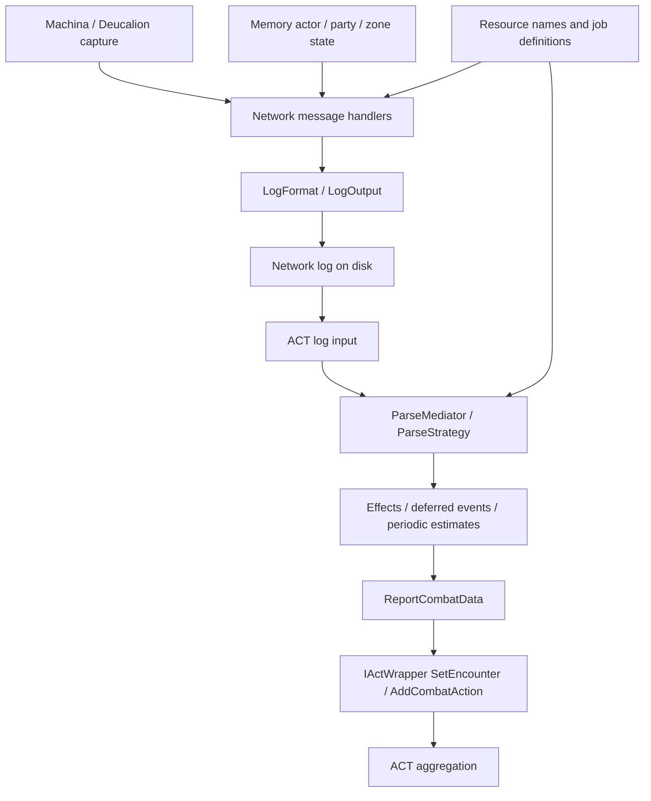

# FFXIV ACT Plugin SDK 3.0.3.3 static analysis

Research date: 2026-10-20. Eight supplied managed DLLs were identified with REA;
selected signatures, CIL anchors/calls, and small raw IL bodies were checked.
Original assemblies were not loaded or executed. This initially examined an
independent-parser alternative; the approved [blueprint](blueprint.md) reuses the
existing plugin and reconstructs its ACT host instead.

## Functional boundaries

This is a selected static call graph, not an observed thread schedule or every
live/import path. A TemporalStasis-style proxy replaces a capture inlet, not actor
state reconstruction, log formatting, semantic combat interpretation, or ACT
aggregation. No independent replacement for these components is selected now.

| DLL | Observed responsibility |
| --- | --- |
| Network | Collector startup, regional handler selection, ability/cast/effect decoding |
| Memory | Process, combatant, owner, party, stats, zone state |
| Logfile | Body formats, timestamps, record types, checksum, writer queue |
| Parse | Stateful interpretation, effect strategies, ACT combat reporting |
| Resource | 81 embedded resources including names and job action/status definitions |
| Common | Repository/subscription/wrapper contracts |
| Config | Parser settings and error-reporting interfaces |
| Main plugin | ACT UI/log hooks and component wiring |

## Capture and actor state

| Method | Token | Observation |
| --- | --- | --- |
| Network.ScanPackets.StartScan | 0x06000025 | Creates FFXIVNetworkMonitor, configures process/region/callbacks; UseDeucalion=true at IL170/171 |
| NetworkMessageReceived | 0x06000027 | ProcessPacket and external NetworkReceived paths |
| NetworkMessageSent | 0x06000028 | External NetworkSent |
| PacketHandlerMediator.LoadPacketHandlers | 0x0600001e | Opcode registration and regional namespaces |
| ProcessPacket | 0x0600001f | Time conversion, regional lookup, length check, handler call |
| IPacketHandler | 0x02000019 | Opcode, PacketType, PacketLength, Process(byte[], DateTime) |

AssemblyRefs name Machina.FFXIV 2.4.8.1 and Machina 2.3.1.3. UseDeucalion=true is
not evidence of successful injection. No direct Unscrambler AssemblyRef/MemberRef
was observed in selected Network/Memory scope; Machina and native Deucalion
internals were not examined, so deobfuscation absence does not follow.

Common network delegates carry string connection, int64 epoch, byte[] message.
Do not equate this with raw TCP frames or TemporalStasis IPC without checking
framing and timestamp conversion. [Delivery analysis](act-event-delivery-analysis.md)
restores parameter names and public asynchronous dispatch separately.

Ability.ProcessAbility (0x0600002f) reads actor Name/OwnerID, HP/MP maxima/current,
position/heading and action names before FormatNetworkAbilityMessage, WriteLine,
and OnParsedLogLine. State suppliers include CopyCombatant_Global (0x06000108),
PartyProcessor.Refresh (0x06000125), PlayerProcessor.Refresh (0x0600012e), and
ZoneMapProcessor.Refresh (0x06000143). Memory declares kernel32 OpenProcess and
ReadProcessMemory. Whether network-only reconstruction suffices, especially for
actors predating capture, owners, zone transitions and reconnects, is unverified.

## Log-to-combat interpretation

| Processing step | Method/token |
| --- | --- |
| ACT hook | ACT_UIMods.OFormActMain_BeforeLogLineRead 0x0600004e (main) |
| Cleanup/deferred/strategy dispatch | ParseMediator.BeforeLogLineRead 0x06000029 |
| Strategy selection | ParseStrategyFactory.GetParseStrategy 0x060001d0 |
| Action effect parse | ParseStrategyActionEffect.Parse 0x060001b8 |
| Effect strategy registration/order/application | LoadStrategies/ApplyStrategies 0x06000237/238 |
| Damage/heal/resource report | ReportActionEffect 0x060001ba |
| ACT wrapper action after SetEncounter | ReportCombatData.AddCombatAction 0x0600004f |
| Combat end request | ReportCombatData.StopCombat 0x06000050 |

GetCombatantName, GetParentName, and CheckParseFilter use player/parent/party,
world/name and configuration. Pet ownership and party filtering are stateful.
Observed strategies include OverHeals, SourceDirectHit, CriticalHitDamage/Heal,
RedirectLimitBreak, ProcDamage/Heal and ApplyStatusEffectsDamage/Heal. Their
presence does not restore every job/filter/effect branch.

## Small effect getter rules

| Rule | Restored expression | Parse token |
| --- | --- | --- |
| Damage amount | Value + (Flags2 & 0x40 != 0 ? Flags1 * 65536 : 0) | 0x060000b3 |
| Heal amount | Identical IL to damage amount | 0x060000e2 |
| Source entry | Flags2 & 0x80 != 0 | 0x060000af |
| Critical | Param0 & 0x20 != 0 | 0x060000b5 |
| Direct hit | Param0 & 0x40 != 0 | 0x060000b6 |

Value returns UInt16; Flags1/Flags2/Param0 return Byte. Example: Value=0x1234,
Flags1=2, Flags2=0x40 gives 0x21234. These are explanatory vectors, not executed
game packets or established raw packet offsets. Both amount bodies have IL SHA-256
e8c92c453cfa526e6c5d8272ea116d10abb47ee786d309fd4e4fca432020677e.

| Periodic/overheal path | Static observation; unresolved scope |
| --- | --- |
| ParseStrategyDoT.Parse 0x060001ce | Stores timestamp/amount/source/target/status/HP as DeferredEvent; timing/order unresolved |
| DeferredEventProcessor.Process 0x06000009 | Calls IDoTSimulator.ProcessTick; all expiry/error/drain conditions unresolved |
| DoTSimulator.ProcessTick 0x06000014 | Settings, AddDoTEntry/AddGroundAoeEntry/SimulateTicks |
| CalculateAmount 0x06000012 | TrackingState damage/heal potency, status multipliers, low byte; full formula unresolved |
| SimulateTicks 0x06000018 | Simulated damage/heal/overheal; overlapping caster attribution unverified |
| OverHeals.Apply 0x060001fb | HP/maxHP and ProcTargetId determine OverHealAmount; all ordering/redirect conditions unresolved |

Bard/Sage resources were extracted without execution and their payload hashes
checked. They include timeproc, potency, maxticks, multipliers, damageshield.
Historical potency data is not a current-game specification. The JSON-like files
contain trailing commas; originals were preserved rather than regex-repaired.
Offsets/hashes are in sdk-3.0.3.3-resource-samples.json.

## Writer rules

LogOutput.WriteLine (0x06000049) and small helpers establish these selected rules.

| Field | Restored behavior |
| --- | --- |
| line | Decimal type padded to at least two digits + pipe + DateTime.ToString("O") + pipe + message with NUL replaced by space |
| Unspecified time | DateTime.MinValue reuses previous time; first use falls back to DateTime.Now |
| Hidden sequence | Reset at type 1 or 253, then increment; that record uses 1 |
| Hash input | UTF-8 of line + pipe + invariant decimal sequence |
| Hash output | First eight SHA-256 bytes as 16 lowercase hex digits |
| Written record | line + pipe + hash; sequence itself is not written |
| Disabled hash | Initial provider-check failure can select a separate "0" path |
| Ability body | Splits uint64 effects into low/high uint32 and writes actor state/additional fields |

This is a hidden-sequence hash, not a chain incorporating the previous checksum.
DateTime.Kind, NUL replacement and reset rules affect bytes. Complete record fields,
newlines/BOM and upstream sanitization remain unverified. Reproducing a checksum
alone does not prove FF Logs acceptance; use the original writer when possible.

## Target and evidence identities

Supplied Linux filenames include literal backslashes (SDK\Name.dll); analysis did
not rename/move them. Common is 3.0.0.0; other selected assemblies are 3.0.3.3,
identified as .NET Framework 4.8 CIL.

| Artifact | SHA-256 |
| --- | --- |
| Main | af1031cdba8eeba8f53dd9d618e58d62d4919bfa77db9b31c568bd04cb359093 |
| Common | 9c3ce07598b6e77a45a6e346bf6c4efbbb09b9cc61a32534f23bc5adcdb03cb1 |
| Parse | aabdeedb35f0e9fb2a833cc55e11cf9f7684ca06cddbaffa2a791754676afea9 |
| Logfile | 2f4faa819df144ca70a17c17e79e45c9cdecf413c98c12fc42b51d73af10b5e7 |
| Network | 7f31bb76930e5e08cfc3b2a4ed747056c0398211eb7fefe6ddc68d3647a8b556 |
| Memory | 0363753efe0d7ae52c0de73653a5436cf83cf655ca47515ce7aa33908f82d897 |
| Resource | 10dc07de16da355b96154cb11550cae7146a0124730e87c71466e84fd63fb33c |
| Config | f965992b4f520ae9aabc2158f925ae4044be647113bc1e7770abb9a6e3b20b2e |

REA parent IDs:

| Scope | Evidence |
| --- | --- |
| Main members/calls | ev_ad7641feec72d06f1e82ffc7dfa63bc104ff2f04fa1754d4e4ec55d74681ab87 |
| Parse | ev_499142007ecbb9b10fe2807f40a6ffe2fecea996149478cbc355379eb236f3f6 |
| Resources | ev_1f3a319737c0a6ed25612503a789c6ed0aeecc9ee0be7d9f0aafda0eb8b3e2dd |
| Network | ev_cdd0f54ae55adfc19e7b88cbb71c51e691ad3ce6fe30a2fb2011a2a18f578945 |
| Memory | ev_68fe92da14645a6c2f020b3dbcd5d18801566779d2900bdbbb32f62dc1a3e05d |
| Common | ev_1bd122a43c24894f3a3f64c7de67bfc677124a1b5cb7a2be2ca9b2d4b6864f9f |
| Logfile | ev_65976a60069ca4271098eed44d9bde478731140b09bbec7af16210abcc3912e9 |

Local evidence under ignored binaries/analysis includes sdk-3.0.3.3-artifacts.json
(MVID/size/identity), core-evidence.json, network-evidence.json and log-evidence.json
(with the sdk-3.0.3.3- prefix). Tokens are artifact-specific. Static complete
coverage means selected metadata/CIL only. Full job/filter semantics, network-only
state replacement, regional opcodes/offsets, live game, native collection, Oodle,
Windows/Linux execution, and FF Logs uploads were not validated.
